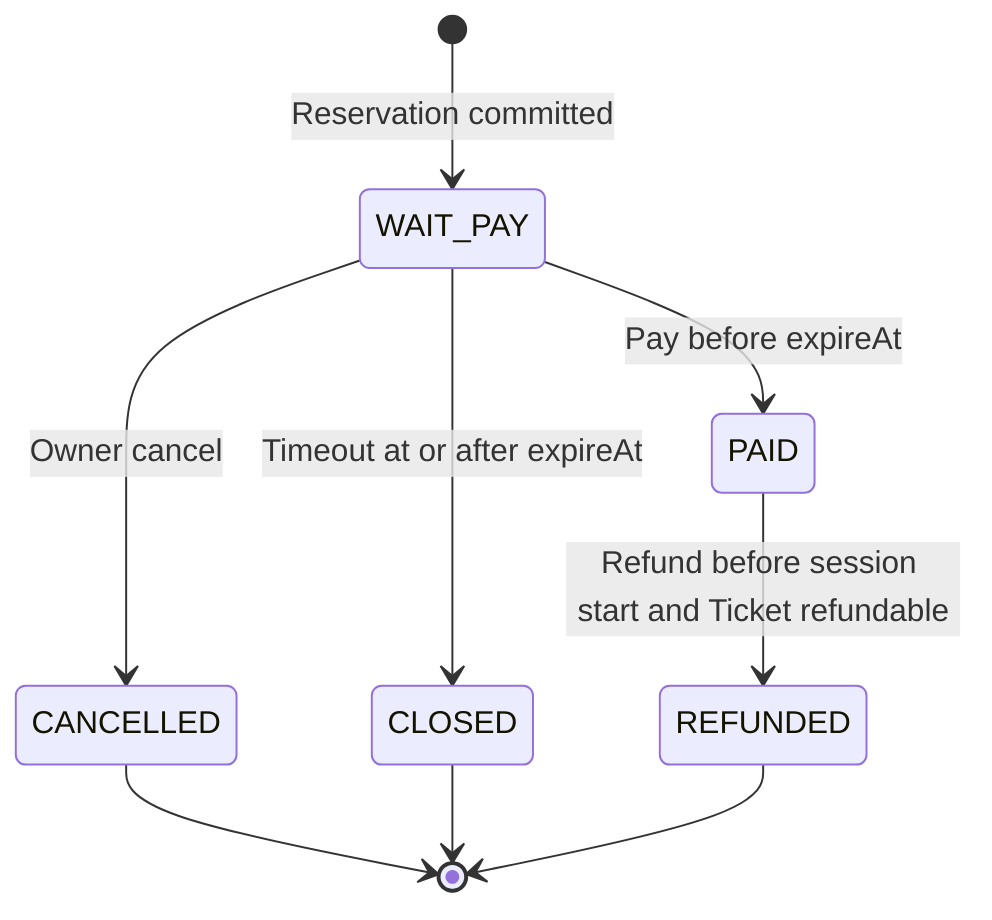
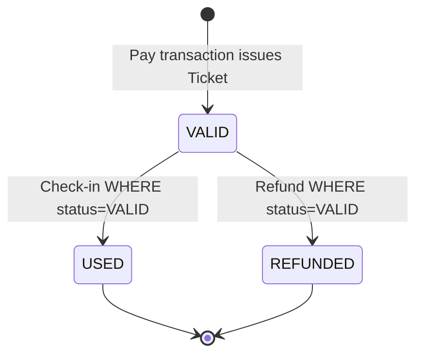

# EventHub 核心业务流程（Core Flows）

本文以当前 Production Code、Mapper SQL、Redis Lua、Flyway migration 和历史集成测试为依据，
描述 EventHub 已实现的核心一致性链路。所有流程都运行在同一个 Spring Boot 应用中；图中的模块
参与者是进程内组件，不是独立服务。

## 1. NORMAL Reservation

```mermaid
sequenceDiagram
    autonumber
    actor Client
    participant App as eventhub-app
    participant Order as OrderService
    participant Event as Event Public API
    participant Inventory as Inventory API
    participant MySQL

    Client->>App: Authenticated POST /api/sessions/{sessionId}/orders
    App->>Order: ReservationApi.reserve(userId, sessionId)
    Note over Order,MySQL: Begin READ_COMMITTED local transaction
    Order->>Event: getPublishedSession(sessionId)
    Event-->>Order: Published EventSession
    Note over Order: Require saleMode=NORMAL<br/>Validate [saleStartAt, saleEndAt)<br/>expireAt=now+15 minutes
    alt Insert, inventory lock, and reload all succeed
        Order->>MySQL: INSERT ticket_order status=WAIT_PAY
        Note over MySQL: UNIQUE(user_id, session_id, purchase_guard)<br/>decides the active-purchase winner
        Order->>Inventory: lockOne(sessionId) [MANDATORY]
        Inventory->>MySQL: UPDATE available-1, locked+1<br/>WHERE available_stock &gt; 0
        Order->>MySQL: Reload inserted Order
        Order->>MySQL: COMMIT
        Order-->>App: OrderView(WAIT_PAY)
        App-->>Client: 201 Created
    else Duplicate purchase, sold out, or participant failure
        Note over Order,MySQL: Stop at the failing operation;<br/>do not execute later participant calls
        Order->>MySQL: ROLLBACK entire local transaction
        Order-->>App: Business failure
        App-->>Client: Business error
    end
```

### 为什么这样设计

Order INSERT 明确发生在 Inventory UPDATE 之前。系统不执行
“先查询是否有 active order，再决定是否插入”的 correctness check；并发下的一人一场次有效购买
由 generated `purchase_guard` 和唯一约束兜底。NORMAL 库存 winner 由单条条件 UPDATE 的
`affectedRows` 决定，不使用 JVM lock、Redis lock 或 `SELECT FOR UPDATE`。

### 正确性边界

`OrderService.reserve` 持有 `READ_COMMITTED` 事务，`InventoryService.lockOne` 以
`MANDATORY` 加入。库存不足、重复购买或 participant 异常都会回滚已插入的 `WAIT_PAY` Order。

核心证据：

- [`OrderService.reserve`](../../eventhub-order/src/main/java/com/eventhub/order/service/OrderService.java)
- [`OrderMapper.insertWaitPay`](../../eventhub-order/src/main/resources/mapper/order/OrderMapper.xml)
- [`InventoryMapper.lockOne`](../../eventhub-inventory/src/main/resources/mapper/inventory/InventoryMapper.xml)
- [`V1__baseline_schema.sql`](../../eventhub-app/src/main/resources/db/migration/V1__baseline_schema.sql)
- [`NormalReservationIntegrationTest`](../../eventhub-app/src/test/java/com/eventhub/order/NormalReservationIntegrationTest.java)
- [`NormalReservationConcurrencyIntegrationTest`](../../eventhub-app/src/test/java/com/eventhub/order/NormalReservationConcurrencyIntegrationTest.java)

## 2. FLASH Reservation

```mermaid
sequenceDiagram
    autonumber
    actor Client
    participant App as FlashReservationApplicationService
    participant Redis as Redis + Lua
    participant Order as ReservationApi
    participant Inventory as Inventory API
    participant MySQL

    Client->>App: Authenticated FLASH reservation
    App->>Redis: flash_reserve.lua(sessionId, userId, admissionId)
    Note over Redis: Validate PREPARED, Redis sale time,<br/>P/A/R state and remaining stock
    Redis->>Redis: stock - 1; user = P:admissionId
    Redis-->>App: ADMITTED
    App->>Order: reserveFlash(userId, sessionId)
    Note over Order,MySQL: Begin READ_COMMITTED authoritative MySQL transaction
    alt MySQL validation and writes succeed
        Order->>MySQL: Validate FLASH session and insert WAIT_PAY
        Order->>Inventory: lockOne(sessionId) [MANDATORY]
        Inventory->>MySQL: available - 1; locked + 1
        Order->>MySQL: COMMIT
        Order-->>App: OrderView(WAIT_PAY)
        App->>Redis: flash_reservation_settle.lua ACTIVATE
        alt Matching activation succeeds
            Redis->>Redis: P:admissionId to A:orderId
        else Activation fails after MySQL commit
            Note over App,MySQL: Preserve committed WAIT_PAY result<br/>Redis may temporarily remain P
        end
        App-->>Client: Reservation success
    else Deterministic MySQL or domain rejection
        Note over Order,MySQL: Stop at validation or the failing write;<br/>do not execute later participant calls
        Order->>MySQL: ROLLBACK local transaction
        Order-->>App: Deterministic failure
        App->>Redis: RELEASE_PENDING for matching P
        Redis->>Redis: Delete P and restore stock + 1
        App-->>Client: Business error, or unavailable if compensation fails
    else Ambiguous MySQL outcome
        Order-->>App: Outcome cannot be classified safely
        Note over App,Redis: Retain P; do not risk duplicate stock restoration
        App-->>Client: FLASH service unavailable
    end
```

### 四个 Lua primitive

| Script | 当前职责 |
|---|---|
| [`flash_prepare.lua`](../../eventhub-inventory/src/main/resources/lua/flash_prepare.lua) | 建立/校验 `PREPARED` meta、capacity、stock 与销售窗口；支持等价幂等准备 |
| [`flash_reserve.lua`](../../eventhub-inventory/src/main/resources/lua/flash_reserve.lua) | 原子检查窗口、用户 P/A/R 与 stock；成功时 `stock - 1`、写入 `P:<admissionId>` |
| [`flash_reservation_settle.lua`](../../eventhub-inventory/src/main/resources/lua/flash_reservation_settle.lua) | 匹配 pending 的 `P → A` 激活，或确定失败后的 pending release；包含 identity fencing |
| [`flash_order_lifecycle.lua`](../../eventhub-inventory/src/main/resources/lua/flash_order_lifecycle.lua) | Cancel/Timeout 的 A release，以及 Refund 的 `A → R`；恢复 admission stock |

Redis 稳定逻辑不变量为：

```text
stock + count(P) + count(A) = capacity
```

`R:<orderId>` 不再占用 admission stock，但仍保留历史购买 fence，阻止同一用户再次 admission。

### 正确性与失败边界

- MySQL 始终是 Order/Inventory 的最终事实，Redis 是 derived admission/execution state。
- Redis Lua 与 MySQL 事务之间没有原子提交或分布式事务。
- 只有 `ADMITTED` 才进入同步 MySQL Reservation。
- Cancel/Timeout/Refund 先提交 MySQL，再进行 best-effort Redis lifecycle sync；Pay 不修改 Redis。
- 当前没有 async reservation、RabbitMQ booking、automatic retry/reconciliation 或 Redis crash recovery。

核心证据：

- [`FlashReservationApplicationService`](../../eventhub-app/src/main/java/com/eventhub/application/flash/FlashReservationApplicationService.java)
- [`FlashOrderLifecycleApplicationService`](../../eventhub-app/src/main/java/com/eventhub/application/flash/FlashOrderLifecycleApplicationService.java)
- [`RedisFlashAdmissionAdapter`](../../eventhub-inventory/src/main/java/com/eventhub/inventory/redis/RedisFlashAdmissionAdapter.java)
- [`FlashReservationIntegrationTest`](../../eventhub-app/src/test/java/com/eventhub/flash/FlashReservationIntegrationTest.java)
- [`FlashReservationFailureIntegrationTest`](../../eventhub-app/src/test/java/com/eventhub/flash/FlashReservationFailureIntegrationTest.java)

## 3. Payment / Ticket / Notification

```mermaid
sequenceDiagram
    autonumber
    actor Client
    participant App as PaymentNotificationApplicationService
    participant Order as OrderService
    participant Inventory as Inventory API
    participant Ticket as Ticket API
    participant MySQL
    participant Publisher as Notification Publisher
    participant RabbitMQ
    participant Consumer as TicketIssuedNotificationConsumer
    participant Notification as UserNotificationService

    Client->>App: Pay order
    App->>Order: OrderCommandApi.pay(userId, orderId)
    Note over Order,MySQL: Transaction 1 · READ_COMMITTED authoritative Pay
    Order->>MySQL: WAIT_PAY to PAID<br/>WHERE not expired
    Order->>Inventory: confirmSoldOne(sessionId) [MANDATORY]
    Inventory->>MySQL: locked - 1; sold + 1
    Order->>Ticket: issueTicket(orderId, userId, sessionId) [MANDATORY]
    Ticket->>MySQL: INSERT Ticket status=VALID
    Order->>MySQL: COMMIT Transaction 1
    Order-->>App: PaymentResult(Order, Ticket)

    Note over App,RabbitMQ: Post-commit best-effort notification
    App->>Publisher: publish TicketIssuedEvent
    Publisher->>RabbitMQ: Persistent JSON message
    Publisher-->>App: Local publish invocation returns
    par HTTP completes without waiting for Consumer
        App-->>Client: Pay result
    and Independent asynchronous delivery
        RabbitMQ-->>Consumer: Deliver event
        Consumer->>Notification: recordTicketIssued(event)
        Note over Notification,MySQL: Transaction 2 · independent READ_COMMITTED projection
        Notification->>MySQL: INSERT user_notification
        Notification->>MySQL: COMMIT Transaction 2
        Notification-->>Consumer: Success or verified equivalent duplicate
        Consumer-->>RabbitMQ: AUTO ACK after successful listener return
    end
```

### 两个数据库事务

Transaction 1 由 Order 持有，原子覆盖：

```text
WAIT_PAY → PAID
Inventory locked → sold
Ticket INSERT VALID
```

任一 participant 失败都会回滚 Order、Inventory 和新 Ticket。RabbitMQ 不参与该事务。

Transaction 2 由 Notification 模块的 `UserNotificationService` 持有，只负责
`user_notification` 投影。V5 提供两条幂等安全线：

```text
UNIQUE(event_id)
UNIQUE(type, business_reference)
```

等价重复只有在持久化事实校验一致后才按成功完成；冲突消息失败。Listener 使用 Spring AMQP
`AUTO` acknowledgement，且 `default-requeue-rejected=false`。

### 失败限制

- Event 构造或 Rabbit publish 失败不能反转已提交的 Pay。
- Consumer/notification transaction 失败不能反转 Pay。
- 当前失败消息不重新入队；publish 或 consume failure 可能造成通知丢失。
- 未实现 Outbox、Publisher Confirm/Return、Retry/DLQ、Guaranteed Delivery 或端到端 Exactly-once。

核心证据：

- [`PaymentNotificationApplicationService`](../../eventhub-app/src/main/java/com/eventhub/application/notification/PaymentNotificationApplicationService.java)
- [`RabbitNotificationEventPublisher`](../../eventhub-notification/src/main/java/com/eventhub/notification/rabbit/RabbitNotificationEventPublisher.java)
- [`TicketIssuedNotificationConsumer`](../../eventhub-notification/src/main/java/com/eventhub/notification/consumer/TicketIssuedNotificationConsumer.java)
- [`UserNotificationService`](../../eventhub-notification/src/main/java/com/eventhub/notification/service/UserNotificationService.java)
- [`V5__create_user_notification.sql`](../../eventhub-app/src/main/resources/db/migration/V5__create_user_notification.sql)
- [`PaymentNotificationRabbitUnavailableIntegrationTest`](../../eventhub-app/src/test/java/com/eventhub/notification/PaymentNotificationRabbitUnavailableIntegrationTest.java)
- [`NotificationConsumerRabbitIntegrationTest`](../../eventhub-app/src/test/java/com/eventhub/notification/NotificationConsumerRabbitIntegrationTest.java)

## 4. Order Lifecycle



Order 状态竞争由 [`OrderMapper.xml`](../../eventhub-order/src/main/resources/mapper/order/OrderMapper.xml)
中的条件 UPDATE 决定：Pay、Cancel、Timeout 都要求当前状态为 `WAIT_PAY`；Refund 要求 `PAID`。
因此同一竞争窗口只有一个有效状态转换 winner。

- Pay 要求 `expire_at > paymentNow`。
- Timeout 要求 `expire_at <= scanNow`。
- Cancel 只要求当前为 `WAIT_PAY`，不额外要求尚未过期。
- Refund 要求 Owner、`refundTime < session.startAt`，并且 Ticket 仍可退款。
- 重复 Pay/Cancel 是状态冲突；重复 Timeout 是 no-op。
- 重复 Refund 在观察到 `REFUNDED` 后返回幂等结果，不产生新的数据库状态转换或 participant mutation。
- `CANCELLED`、`CLOSED`、`REFUNDED` 是终态。

历史验证见
[`OrderLifecycleIntegrationTest`](../../eventhub-app/src/test/java/com/eventhub/order/OrderLifecycleIntegrationTest.java)、
[`OrderTimeoutIntegrationTest`](../../eventhub-app/src/test/java/com/eventhub/order/OrderTimeoutIntegrationTest.java) 和
[`RefundOrchestrationIntegrationTest`](../../eventhub-app/src/test/java/com/eventhub/refund/RefundOrchestrationIntegrationTest.java)。

## 5. Ticket Lifecycle



Check-in 由 App 的
[`CheckInApplicationService`](../../eventhub-app/src/main/java/com/eventhub/application/checkin/CheckInApplicationService.java)
持有 `READ_COMMITTED` 本地事务；Ticket 的 check-in mutation 使用 `MANDATORY` 参与。Refund 则由
Order transaction 调用 Ticket refund participant。

两条转换都依赖 `WHERE status='VALID'` 条件更新：

- Check-in 获胜时 Ticket 成为 `USED`，Refund 不能提交。
- Refund 获胜时 Ticket 成为 `REFUNDED`，Check-in 被拒绝。
- 不存在 `USED → REFUNDED`。

历史验证见
[`TicketCheckInFoundationIntegrationTest`](../../eventhub-app/src/test/java/com/eventhub/ticket/TicketCheckInFoundationIntegrationTest.java)
和 [`RefundParticipantIntegrationTest`](../../eventhub-app/src/test/java/com/eventhub/refund/RefundParticipantIntegrationTest.java)。

## 6. Inventory 与唯一性不变量

| 不变量 | 机制 |
|---|---|
| `total_stock = available_stock + locked_stock + sold_stock` | MySQL CHECK constraint |
| 所有库存计数 `>= 0` | MySQL CHECK + 条件 UPDATE |
| 每个 Session 一条 Inventory | `UNIQUE(event_inventory.session_id)` |
| 同用户同 Session 一个受保护购买历史 | generated `purchase_guard` + unique constraint |
| 一个 Order 最多一张 Ticket | `UNIQUE(ticket.order_id)` |
| 同用户同 Session 最多一张 Ticket | `UNIQUE(ticket.user_id, ticket.session_id)` |

[`V3__add_refunded_order_and_ticket_status.sql`](../../eventhub-app/src/main/resources/db/migration/V3__add_refunded_order_and_ticket_status.sql)
将 `REFUNDED` 保留在 `purchase_guard=1` 的范围内。退款会恢复可售库存，但不会清除历史购买资格；
同一用户不能因为退款而再次购买同一 Session，`REFUNDED` Ticket 历史也继续由唯一约束保护。

## 7. Failure Boundaries

| Failure | 当前行为 | 当前限制 |
|---|---|---|
| NORMAL participant failure | 回滚同一 MySQL transaction | 热点 Session 仍可能产生数据库行竞争 |
| FLASH deterministic MySQL rejection | 释放匹配 P，恢复 Redis admission stock | 补偿本身依赖 Redis 可用 |
| FLASH ambiguous MySQL result | 保守保留 P | 没有自动恢复/对账 |
| MySQL commit 后 Redis activation/sync 失败 | 保留已提交 MySQL 结果 | Redis derived state 可能暂时不一致 |
| Pay transaction failure | 不发布 Ticket-issued event | 客户端收到权威事务失败 |
| Pay commit 后 Rabbit publish 失败 | Pay 保持成功 | Notification 可能丢失 |
| Notification consumer failure | 不影响 Pay | 当前 no-requeue，无 Retry/DLQ |

这些边界体现当前演进阶段：先保证 MySQL 业务正确性，再显式暴露跨 Redis/RabbitMQ 的可靠性限制，
而不是用不存在的分布式事务或 Exactly-once 承诺掩盖失败窗口。

## 8. Source References

- [架构总览](overview.md)
- [EventHub V1 说明书](../specification/eventhub-v1.md)
- [数据库 Schema](../database/schema.md)
- [开发进度与历史验证](../development/progress.md)
- [OrderService](../../eventhub-order/src/main/java/com/eventhub/order/service/OrderService.java)
- [Inventory Mapper SQL](../../eventhub-inventory/src/main/resources/mapper/inventory/InventoryMapper.xml)
- [TicketService](../../eventhub-ticket/src/main/java/com/eventhub/ticket/service/TicketService.java)
- [Ticket Mapper SQL](../../eventhub-ticket/src/main/resources/mapper/ticket/TicketMapper.xml)
