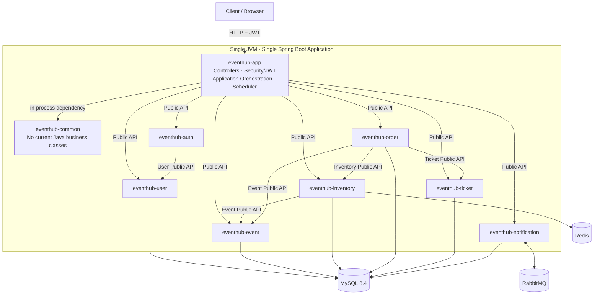

# EventHub 架构总览（Architecture Overview）

EventHub 是一个面向活动预约与限量票务场景的 Java 后端项目。当前系统采用
**Maven 多模块 + 模块化单体（Modular Monolith）**：所有模块由一个 Spring Boot
应用组装，在同一个 JVM 内通过公开 Java API 协作。

本文只描述当前已经实现的架构事实。NORMAL/FLASH 抢票、支付、Ticket、退款、
核销与通知的详细执行顺序见 [核心业务流程](core-flows.md)。

## 1. 架构定位

- 单个 JVM、单个 Spring Boot Application、单个部署产物。
- `eventhub-app` 是 Composition Root、HTTP/Security 接入层和应用编排入口。
- Maven 模块是代码与职责边界，不是独立服务。
- 跨模块调用只通过目标模块的 `api` package，在进程内同步完成。
- MySQL 保存权威业务状态；Redis 和 RabbitMQ 不取代 MySQL 的事实来源地位。

这套结构保留了清晰的领域边界，同时避免在当前规模下引入服务发现、远程调用、
分布式事务和多部署单元的运维复杂度。

## 2. 系统架构图



图中的箭头表示 Maven 依赖或进程内 Public API 调用，不表示模块之间存在 HTTP、
RPC 或独立部署关系。唯一启动入口是
[`EventHubApplication`](../../eventhub-app/src/main/java/com/eventhub/EventHubApplication.java)。

## 3. 模块职责

| 模块 | 当前职责 |
|---|---|
| `eventhub-common` | 当前没有 Java 业务类；不承载领域模型或跨模块业务逻辑 |
| `eventhub-user` | 用户账户、凭据与用户资料 |
| `eventhub-auth` | 注册、登录、密码校验与 JWT contract |
| `eventhub-event` | Event/EventSession、发布状态、销售模式、核销授权 |
| `eventhub-inventory` | MySQL 库存转换；FLASH Redis Key、Adapter 与 Lua primitive |
| `eventhub-order` | Order 状态机；Reserve、Pay、Cancel、Timeout、Refund 的权威 MySQL 事务编排 |
| `eventhub-ticket` | Ticket 签发、查询、核销与退款参与者 |
| `eventhub-notification` | `TicketIssuedEvent`、RabbitMQ topology/publisher/consumer 与通知投影 |
| `eventhub-app` | 启动、HTTP、JWT/Security、ApplicationService、Scheduler、配置与模块组装 |

业务模块的 Mapper、Repository、内部 Service、Redis Adapter 和 MQ 实现均属于模块内部。
外部模块只能使用目标模块公开的 `api` package；例如 Order 通过
[`InventoryReservationApi`](../../eventhub-inventory/src/main/java/com/eventhub/inventory/api/InventoryReservationApi.java)
参与库存转换，而不会直接访问 `InventoryMapper`。

## 4. Maven 依赖边界

当前业务模块依赖边只有：

```text
auth      → user
inventory → event
order     → event
order     → inventory
order     → ticket
app       → common, user, auth, event, inventory, order, ticket, notification
```

其余业务模块没有额外的 EventHub 模块依赖，依赖图不存在环。实际依赖以
[`pom.xml`](../../pom.xml) 和九个 module POM 为准。

这组依赖体现两个约束：

1. `eventhub-app` 可以组装所有业务模块，但不能绕过 Public API 访问内部实现。
2. Order-owned 生命周期是经过冻结的窄例外，不代表 Order 可以成为所有跨领域流程的编排中心。

## 5. 基础设施所有权

### MySQL

MySQL 是 Order、Inventory、Ticket 和 Notification 等持久业务事实的 Source of Truth。
正式 Schema 由 `eventhub-app` 中的
[`V1`–`V5` Flyway migrations](../../eventhub-app/src/main/resources/db/migration/)
管理。各业务模块拥有自己的 Entity、Mapper 与 SQL，不跨模块访问持久化实现。

### Redis

Redis 当前用于 FLASH admission/execution state。`eventhub-inventory` 拥有两个
hash-tagged Key、Redis Adapter 和四个 Lua 脚本；`eventhub-app` 负责 Redis admission、
同步 MySQL Reservation 以及提交后的 best-effort lifecycle synchronization。

Redis 不是最终订单账本。当前没有 Redis/MySQL 分布式事务，也没有自动对账或崩溃恢复。

### RabbitMQ

RabbitMQ 当前只承载非关键的 Ticket-issued Notification。`eventhub-notification`
拥有 durable direct topology、JSON publisher 和 consumer。RabbitMQ 不参与 Pay 的
权威事务；消息发布发生在 Pay 已提交之后。

当前通知是 best-effort：尚未实现 Transactional Outbox、Publisher Confirm/Return、
Retry/DLQ 或 Guaranteed Delivery。

## 6. 事务与一致性边界

| Use Case | 事务所有者 | 事务参与者 | 边界 |
|---|---|---|---|
| NORMAL/FLASH MySQL Reserve | Order | Inventory `MANDATORY` | `READ_COMMITTED` 本地 MySQL 事务 |
| Pay | Order | Inventory、Ticket `MANDATORY` | Order/Inventory/Ticket 同一事务 |
| Cancel | Order | Inventory `MANDATORY` | 状态与库存释放同一事务 |
| Timeout | Order per-order processor | Inventory `MANDATORY` | 每个过期订单一个事务 |
| Refund | Order | Ticket、Inventory `MANDATORY` | Order → Ticket → Inventory 同一事务 |
| Check-in | App `CheckInApplicationService` | Ticket `MANDATORY` | App-owned `READ_COMMITTED` 事务 |
| Notification consume | Notification `UserNotificationService` | Notification Mapper | 独立 `READ_COMMITTED` 事务 |
| FLASH Redis mutation | Inventory Redis Adapter | 单个 Lua operation | 独立 Redis 原子边界，不加入 MySQL 事务 |

[`OrderService`](../../eventhub-order/src/main/java/com/eventhub/order/service/OrderService.java)
和 [`OrderTimeoutProcessor`](../../eventhub-order/src/main/java/com/eventhub/order/service/OrderTimeoutProcessor.java)
建立 Order-owned 事务；Inventory/Ticket mutation 使用 `Propagation.MANDATORY`，确保没有外层事务时直接失败。

Check-in 不属于 Order 生命周期事务。它由
[`CheckInApplicationService`](../../eventhub-app/src/main/java/com/eventhub/application/checkin/CheckInApplicationService.java)
建立本地事务，在 Event 授权后调用 Ticket participant 完成 `VALID → USED`。

## 7. 一致性原则

```text
MySQL    = authoritative business state
Redis    = FLASH admission and execution state
RabbitMQ = non-critical notification transport
```

- 纯 MySQL 且必须共同成功的操作使用 Spring Local Transaction。
- Order 与 Inventory/Ticket 分属 Maven 模块，但共享 JVM、DataSource 和 TransactionManager，
  因此仍是一个本地事务，不是分布式事务。
- Redis Lua 只保证脚本内部原子性，不能原子覆盖 MySQL commit。
- RabbitMQ publish/consume 与 Pay 分属不同事务；通知失败不能回滚支付。

## 8. 设计取舍

### Modular Monolith vs Microservices

模块化单体提供明确所有权和可测试边界，同时保留单进程调用与本地事务。代价是模块不能独立部署，
且团队必须持续遵守 Public API 边界。

### MySQL correctness vs hot-row contention

NORMAL 使用条件 UPDATE 和数据库唯一约束决定并发 winner，正确性清晰且无需分布式锁；热点 Session
仍可能形成 MySQL 行竞争，这是后续真实性能测试需要观察的成本。

### Redis admission vs cross-system consistency window

FLASH 通过 Lua 原子减少入口竞争，但 Redis admission 与 MySQL Order 不可能原子提交，因此需要
pending、fencing、确定失败补偿以及“模糊结果不冒险释放”的保守策略。当前仍可能出现待人工处理的
Redis/MySQL 不一致窗口。

### Best-effort Notification vs guaranteed delivery

通知在 Pay 提交后发送，避免非关键通知破坏支付正确性；代价是 broker outage 或 consumer failure
可能造成通知丢失。可靠投递能力属于后续演进，当前文档不作保证。

## 9. 相关文档

- [核心业务流程](core-flows.md)
- [EventHub V1 说明书](../specification/eventhub-v1.md)
- [数据库 Schema](../database/schema.md)
- [数据库索引](../database/indexes.md)
- [开发进度与历史验证](../development/progress.md)
